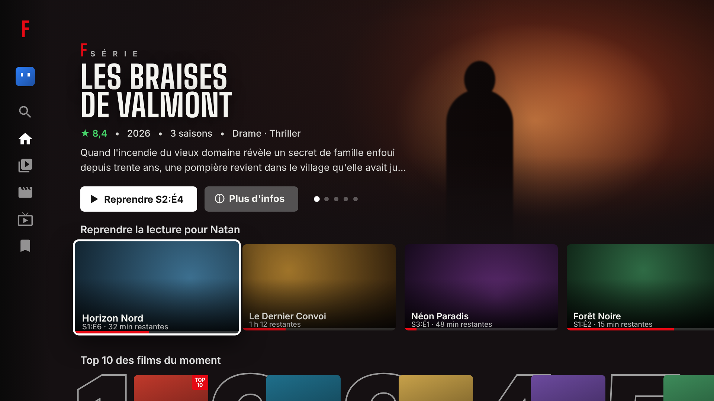

# Flux TV — refonte IPTV du X96 mini



Flux TV transforme le X96 mini en boîtier IPTV dédié : il démarre directement sur une
interface façon Netflix (accueil avec visuel plein écran, rangées de films/séries, guide TV avec
aperçu vidéo, lecteur plein écran), connectée à votre abonnement **Xtream Codes**
(URL du serveur + nom d'utilisateur + mot de passe).

L'interface d'origine du boîtier est désactivée, les applis inutiles sont coupées et
Android est réglé pour la performance. Android reste en dessous, invisible, parce que c'est lui
qui pilote le décodeur vidéo matériel de la puce Amlogic S905W. Sans lui, pas de 1080p/4K fluide
sur ce processeur (voir la FAQ en bas).

---

## Ce que fait l'appli (v2 — DA premium)

**Direction artistique** : noirs chauds « cocooning », rouge Flux, polices **Inter** (interface)
et **Big Shoulders** (titres façon affiche de cinéma), fondus enchaînés partout, lent zoom
« Ken Burns » sur les visuels, et **couleur d'ambiance** : le fond se teinte doucement avec la
couleur dominante de l'affiche sélectionnée, comme sur Netflix.

| Écran | Contenu |
|---|---|
| **Intro + « Qui regarde ? »** | Logo animé au démarrage, jusqu'à 5 **profils** avec avatar et couleur. Chaque profil a son propre historique, sa liste, ses « J'aime » et ses langues audio/sous-titres |
| **Accueil** | **Billboard à la une** qui défile tout seul (▶ Lecture / ⓘ Plus d'infos), rangées *Reprendre la lecture pour [profil]*, **Top 10 des films / séries** avec grands chiffres détourés, *Ma liste*, *Parce que vous avez regardé…*, nouveautés, catégories. Badges « RÉCEMMENT AJOUTÉ » et « TOP 10 » sur les affiches |
| **Menu latéral** | Rail d'icônes qui s'ouvre au focus (Recherche, Accueil, Séries, Films, Nouveautés, TV en direct, Ma liste, Paramètres, profil) |
| **Fiche film / série** | Visuel plein écran, note, durée, genres, casting, bouton **Reprendre** avec barre de progression, *Depuis le début*, Ma liste, J'aime ; saisons, épisodes avec vignettes, badge **VU** et **À SUIVRE**, temps restant ; *Titres similaires* |
| **Lecteur** | Contrôles maison façon Netflix, avance/retour **accéléré** quand on maintient la touche, aperçu du temps, **épisode suivant avec compte à rebours** pendant le générique, enchaînement automatique, **« Vous regardez toujours ? »** après 3 épisodes, panneau **audio & sous-titres**, vitesse de lecture, reprise automatique (« Reprise à 42:10 ») |
| **TV en direct** | Guide : Récemment regardées / Favoris / catégories, aperçu vidéo avec badge **EN DIRECT**, programme en cours et suivant. En plein écran : ▲▼ zapping, ◀ liste des chaînes, chiffres = n° de chaîne |
| **Recherche** | Clavier à l'écran (pas besoin du clavier Android), accents ignorés, résultats en grille, suggestions quand la recherche est vide |

**Historique façon Netflix** : la position est sauvegardée toutes les 15 s et à chaque sortie ;
un film à 95 % est considéré comme vu ; sur une série, « Reprendre » relance l'épisode en cours
ou passe automatiquement au suivant s'il est terminé ; la rangée *Reprendre la lecture* lance
directement la lecture (appui long = retirer de la rangée, Ma liste, Plus d'infos).

**Télécommande — films/séries** : OK = pause + contrôles · ◀ ▶ = reculer/avancer (maintenir
pour accélérer : 10 s → 30 s → 1 min) · Retour = masquer les contrôles puis quitter.
**Direct** : ▲ / CH+ = chaîne suivante · ▼ / CH- = précédente · ◀ = liste des chaînes ·
chiffres = aller à la chaîne n° · OK = bandeau d'infos.

### Optimisations pour le X96 mini (S905W, 1-2 Go de RAM)
- Décodage vidéo 100 % matériel (ExoPlayer/Media3, rendu SurfaceView).
- Mémoire tampon **plafonnée en octets** (24 à 64 Mo) : pas de saturation de la RAM en 4K.
- Flux TS : démarrage accéléré (images clés non-IDR acceptées) → zapping plus rapide.
- Connexions HTTP réutilisées (keep-alive) entre listes, images et vidéo.
- Listes du fournisseur lues en flux et mises en cache 6 h sur le disque : démarrage instantané,
  et l'appli fonctionne même si le serveur de listes est lent.
- Images décodées en RGB_565 à la taille exacte de la carte (moitié moins de RAM).
- Wi-Fi verrouillé en mode « haute performance » pendant la lecture (pas de mise en veille radio).
- Reconnexion automatique (6 essais) si le flux coupe.
- 3 profils de mémoire tampon dans Paramètres : Réactif / Équilibré / Stable.
- Le script d'installation compile l'appli en code natif (`compile -m speed`), réduit les
  animations, coupe l'économiseur d'écran, le scan Wi-Fi/Bluetooth en arrière-plan et désactive
  ~40 applis préinstallées.

---

## Étape 1 — Obtenir l'APK (fichier d'installation)

### Option A — Sans rien installer, via GitHub (recommandé)
1. Créez un compte sur https://github.com puis **New repository** (privé si vous voulez).
2. **Add file ▸ Upload files** : glissez **tout le contenu** du dossier `FluxTV`
   (dont le dossier caché `.github`). Validez avec **Commit changes**.
3. Onglet **Actions** : la compilation « Build APK » démarre toute seule (4 à 6 min).
4. Une fois en vert ✔, cliquez dessus ▸ section **Artifacts** ▸ téléchargez **FluxTV-apk**.
   Dézippez : vous obtenez **FluxTV.apk**.

> Si le dossier `.github` n'est pas envoyé (dossier caché), créez-le à la main dans GitHub :
> **Add file ▸ Create new file**, nom `.github/workflows/build.yml`, et collez-y le contenu du
> fichier du même nom.

### Option B — Avec Android Studio
1. Installez Android Studio, **Open** ▸ dossier `FluxTV`. Acceptez la synchronisation Gradle.
2. Menu **Build ▸ Generate App Bundles or APKs ▸ Build APK(s)**, variante *release*
   (ou `gradle assembleRelease` en ligne de commande).
3. L'APK se trouve dans `app/build/outputs/apk/release/app-release.apk` : renommez-le
   **FluxTV.apk**.

---

## Étape 2 — (Facultatif mais conseillé) Remettre le boîtier à zéro

Partir d'un Android propre évite les ralentissements laissés par d'anciennes applis.
- **Par les menus** : Paramètres ▸ Préférences de l'appareil (ou *À propos*) ▸
  **Réinitialisation / Factory data reset**.
- **Si le menu est inaccessible** : boîtier débranché, enfoncez un cure-dent dans la prise AV
  (bouton *reset* caché au fond), maintenez, branchez l'alimentation, relâchez quand le logo
  apparaît ▸ menu *recovery* ▸ **wipe data/factory reset** puis **reboot**.

Ensuite, branchez le câble Ethernet ou configurez le Wi-Fi.

---

## Étape 3 — Activer l'accès ADB sur le boîtier

1. Paramètres ▸ **À propos** ▸ cliquez **7 fois** sur **Numéro de build** (« Vous êtes
   développeur »).
2. Paramètres ▸ **Options pour les développeurs** ▸ activez **Débogage USB** (et
   **Débogage ADB réseau / ADB over network** si l'option existe).
3. Notez l'**adresse IP** du boîtier : Paramètres ▸ Réseau (ex. `192.168.1.50`).

Le PC et le boîtier doivent être sur la **même box internet**.

---

## Étape 4 — Installer et transformer le boîtier (PC)

### Windows
1. Téléchargez **Android SDK Platform-Tools** (site officiel developer.android.com,
   rubrique *platform-tools*), dézippez.
2. Copiez dans **un même dossier** : le dossier `platform-tools`, `FluxTV.apk`, et le contenu
   de `tools/` (`install.bat`, `restore.bat`, `bloat.txt`).
3. Double-cliquez **install.bat**, tapez l'IP du boîtier.
4. Sur la TV, une fenêtre **« Autoriser le débogage USB ? »** apparaît : cochez *Toujours
   autoriser* puis **OK**. (Si le script échoue à cette étape, relancez-le.)

### Mac / Linux
```bash
# platform-tools installé (brew install android-platform-tools  /  apt install adb)
cd dossier-avec-FluxTV.apk-et-tools
./install.sh 192.168.1.50
```

Le script : installe l'appli ▸ la définit comme écran d'accueil ▸ désactive les applis listées
dans `bloat.txt` ▸ applique les optimisations ▸ redémarre. Le boîtier démarre alors directement
sur **Flux TV** : entrez l'URL du serveur, l'utilisateur et le mot de passe, c'est terminé.

> Astuce : vous pouvez coller dans le champ serveur un lien M3U complet
> (`http://serveur:port/get.php?username=XXX&password=YYY&type=m3u`) — les champs se remplissent
> tout seuls.

### Sans PC (installation simple, sans le nettoyage)
1. Copiez `FluxTV.apk` sur une clé USB, branchez-la au boîtier.
2. Paramètres ▸ Sécurité ▸ autorisez les **sources inconnues**.
3. Ouvrez l'APK avec le gestionnaire de fichiers du boîtier ▸ Installer.
4. Appuyez sur la touche **Accueil** de la télécommande ▸ choisissez **Flux TV** ▸ **Toujours**.

---

## Réglages utiles dans l'appli (Paramètres)

- **Format des chaînes** : MPEG-TS (par défaut, le plus compatible) ou HLS (m3u8) si certaines
  chaînes ne démarrent pas.
- **Mémoire tampon** : *Réactif* pour un zapping rapide sur une bonne connexion, *Stable* si
  l'image se fige (Wi-Fi faible).
- **Aperçu vidéo du guide TV** : désactivez-le si le boîtier chauffe ou rame.
- **Tunneling vidéo** : expérimental, peut améliorer la fluidité sur certains firmwares Amlogic.
- **Paramètres Android** : accès au Wi-Fi, à la résolution, au son (le lanceur d'origine étant
  désactivé, c'est par ici).

## Conseils réseau pour ce boîtier
- **Ethernet d'abord** : le Wi-Fi du X96 mini est souvent en 2,4 GHz seulement et limité ;
  le port Ethernet (100 Mb/s) suffit largement pour de la 4K IPTV (25 Mb/s environ).
- En Wi-Fi : boîtier visible, pas derrière la TV ; canal 1, 6 ou 11 sur la box.
- DNS lents ? Dans Paramètres Android ▸ réseau ▸ IP statique, mettez DNS `1.1.1.1` et `8.8.8.8`.
- Résolution de sortie : réglez-la sur celle de la TV (1080p le plus souvent) ; inutile de
  sortir en 4K sur une TV 1080p, cela charge la puce graphique.

---

## Revenir en arrière
`restore.bat` (Windows) ou `./restore.sh IP` (Mac/Linux) réactive toutes les applis
d'origine, remet les animations et peut désinstaller Flux TV. Rien n'est supprimé du système :
les applis ont été *désactivées*, pas effacées.

---

## FAQ

**Pourquoi ne pas effacer complètement Android ?**
Sur le S905W, seul le noyau Android du fabricant sait parler au décodeur vidéo matériel.
Un système écrit de zéro devrait décoder la vidéo par le processeur, ce qui est impossible en
HD sur cette puce. La solution retenue garde le moteur et remplace tout ce que vous voyez et
utilisez. Si vous voulez quand même un système sans Android, **CoreELEC** (Linux + Kodi)
supporte le S905W depuis une carte micro-SD, sans toucher à la mémoire interne. L'IPTV passe
alors par l'extension *PVR IPTV Simple Client* de Kodi, avec l'interface de Kodi, pas celle-ci.

**Une chaîne ne démarre pas.** Essayez le format HLS dans Paramètres, puis le profil
*Stable*. Si elle ne marche pas non plus dans VLC, le problème vient du fournisseur.

**« Identifiant ou mot de passe incorrect » alors qu'ils sont bons.** Vérifiez le port dans
l'URL (`http://serveur.com:8080`) et qu'il n'y a pas d'espace en trop.

**Le boîtier a été mis à jour / l'ancien menu revient.** Relancez `install.bat`.

---

## Structure du projet
```
app/src/main/java/com/flux/tv/
  App.kt                 client HTTP partagé
  data/XtreamApi.kt      API Xtream (listes en flux + cache disque, fiches, EPG)
  data/Repo.kt           données en mémoire, file de lecture
  data/Prefs.kt          compte, profils, historique, positions, favoris, réglages
  ui/ProfilesActivity.kt intro animée + « Qui regarde ? » + gestion des profils
  ui/MainActivity.kt     accueil Netflix : billboard, menu latéral, rangées (lanceur HOME)
  ui/LiveActivity.kt     guide TV avec aperçu
  ui/DetailActivity.kt   fiche film / série, saisons, épisodes
  ui/PlayerActivity.kt   lecteur : contrôles maison, épisode suivant, pistes, zapping
  ui/Ui.kt, Views.kt     polices, couleur d'ambiance, Ken Burns, Top 10, squelettes
  ui/Adapters.kt         cartes (affiche, Top 10, Reprendre, chaîne) et rangées
  ui/PlayerFactory.kt    réglages ExoPlayer pour le S905W
  ui/SearchActivity.kt, SettingsActivity.kt, LoginActivity.kt
tools/                   install / restore (Windows + Mac/Linux), liste des applis désactivées
.github/workflows/       compilation automatique de l'APK sur GitHub
```

## Licences
Polices Inter et Big Shoulders : SIL Open Font License (textes dans `app/src/main/assets/licenses`).
Elles ont été réduites aux caractères latins/français pour peser 300 Ko au lieu de 3 Mo.
